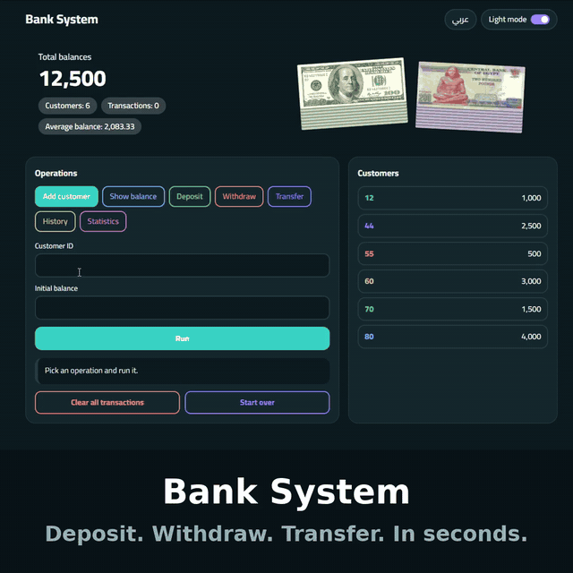

# 🏦 Bank System

A bank management system for handling customer accounts and core banking operations, available as an **interactive web app** and as a **Python version**.



## 📦 Versions

| Version | File | Description |
|---------|------|-------------|
| 🌐 Web app | `Bank System.html` | Interactive interface with light/dark mode and Arabic/English support |
| 🐍 Python | `chat.py` | Python banking system for managing customers, balances, and transactions |

## ✨ Features

- **Add customers** with an ID and an initial balance
- **Show balance** for any customer
- **Deposit** and **withdraw** money
- **Transfer** funds between accounts
- **Transaction history** for every operation
- **Statistics**: total balance, number of customers, number of transactions, average balance, and more

### Web app extras

- 🌗 Light / dark mode
- 🌍 Arabic / English interface (with RTL support)
- **Clear all transactions** and **Start over** to reset to the starting state

## 🛠️ Built With

- HTML, CSS, JavaScript (web app)
- Python (`chat.py`)

## 🚀 How to Run

1. Download or clone the repository:
   ```bash
   git clone https://github.com/AhmedElhosain2010925/Bank-System.git
   ```
2. **Web app:** open `Bank System.html` in any modern browser (Chrome, Edge, Firefox). No installation needed.
3. **Python version:** make sure Python 3 is installed, then run:
   ```bash
   python chat.py
   ```

## 📖 How to Use (web app)

1. Choose an operation from the **Operations** panel (Add customer, Show balance, Deposit, Withdraw, Transfer, History, Statistics).
2. Fill in the required fields (for example: customer ID and amount).
3. Click **Run** and read the result in the message box.
4. Watch the total balance, statistics, and customers list update instantly.

## 🎓 About

Developed as part of my learning journey at **WE School of Applied Technology**, under the supervision of [Ziyad Elshazly](https://www.linkedin.com/in/ziyad-elshazly-47887236a/).

This project helped me practice problem-solving, logical thinking, debugging, and turning banking logic into a practical application.

## 👤 Author

[AhmedElhosain2010925](https://github.com/AhmedElhosain2010925)

---

⭐ If you like this project, feel free to star the repository and share your feedback!
